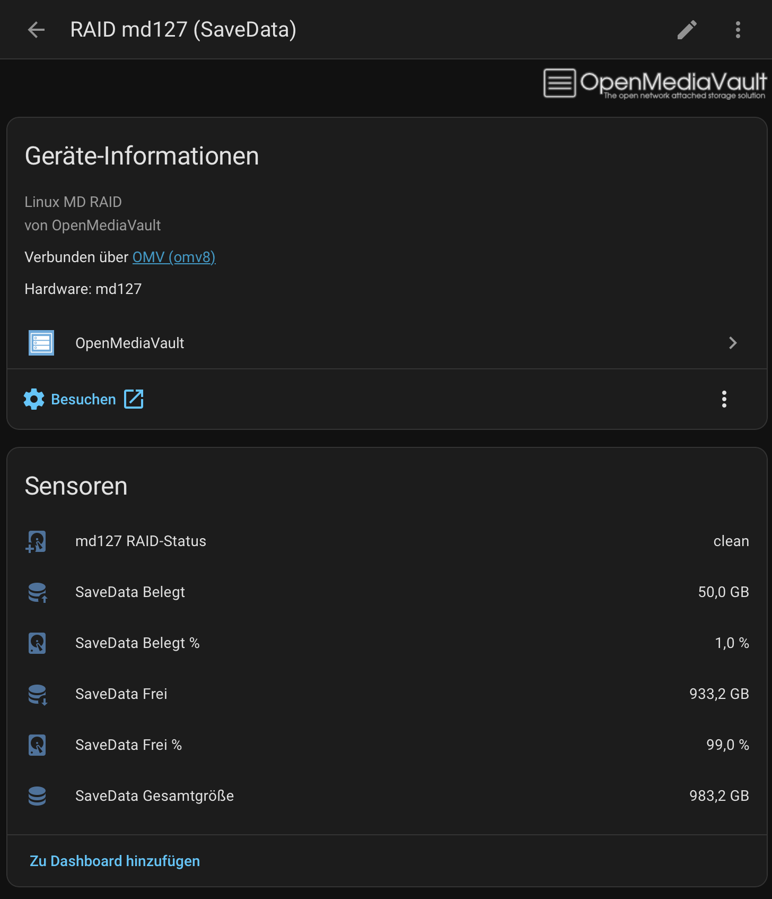

# OpenMediaVault (OMV) for Home Assistant

[](https://hacs.xyz)
[](https://github.com/sponsors/slydlake)

Monitor and control your OpenMediaVault NAS from Home Assistant.

> **Note:** This is an independent community project and is **not** affiliated with or endorsed by the OpenMediaVault project or its developers.


## About

This integration is a full modernization of [tomaae/homeassistant-openmediavault](https://github.com/tomaae/homeassistant-openmediavault), building on the groundwork laid by [cneuen/homeassistant-openmediavault](https://github.com/cneuen/homeassistant-openmediavault). Selected compatibility improvements from [Boci-HA/homeassistant-openmediavault](https://github.com/Boci-HA/homeassistant-openmediavault) have also been incorporated.

The original integration relied on a synchronous, poll-based controller that no longer fits the current Home Assistant architecture. This fork replaces that foundation with a native async client, a `DataUpdateCoordinator`-driven update cycle, and a platform structure aligned with modern HA conventions. Alongside that architectural shift, the scope of what the integration monitors has grown substantially: per-resource device modeling, Docker Compose support, ZFS pool awareness, RAID synthesis, dynamic localized entity names, capacity sensors, and a richer options flow are all new additions rather than ports of existing functionality.

## Features

- Async OMV JSON-RPC client based on aiohttp
- DataUpdateCoordinator architecture for predictable polling and updates
- CPU, memory, temperature, filesystem, disk, SMART, network, RAID, and optional ZFS monitoring
- Per-resource device modeling — disks, RAIDs, filesystems, ZFS pools, and Docker containers each appear as separate HA devices
- Docker Compose support with per-container state, version, and lifecycle button entities
- Kubernetes workload monitoring through the openmediavault-k8s plugin, with state, restarts, CPU and memory per workload plus a button that recreates its pods
- Native Home Assistant update entity with pending package count, per-package release details in the More Info dialog, a direct link to the OMV updates page, one-click package installation, and reboot-only mode when no further packages are pending
- Binary sensor for reboot requirement and OMV service health
- Reboot and shutdown buttons
- Localized dynamic entity names that follow the active HA language

## Supported Versions

- OpenMediaVault 7 and 8
- Home Assistant 2025.5 or newer
- Python 3.13.2 or newer for local development and CI

The active integration domain is omv.

## Screenshots





## Installation

### Install using HACS (recommended)

[](https://my.home-assistant.io/redirect/hacs_repository/?owner=slybase&repository=homeassistant-openmediavault&category=integration)

To add manually: open **HACS** > **Integrations** > three-dot menu > **Custom repositories** > add `https://github.com/slybase/homeassistant-openmediavault` (category: Integration) > **Download**.

After installing, restart Home Assistant. Then open **Settings** > **Devices & Services** > **Add Integration** and search for **OpenMediaVault**.

### Install manually

Copy `custom_components/omv/` from this repository into your HA `config/custom_components/` directory. Restart Home Assistant, then add the integration as described above.

## Setup

The config flow asks for:

| Field | Example | Notes |
|---|---|---|
| **Host** | `192.168.1.100` or `mynas.local` | IP address or hostname — **no** `http://` prefix and **no** port suffix |
| **Username** | `admin` | Default OMV admin account |
| **Password** | _(your OMV password)_ | |
| **Port** | `80` | Default for HTTP. Use `443` (or your custom port) when SSL is enabled |
| **SSL** | off | Enable if your OMV is reachable via HTTPS |
| **SSL verification** | on | Disable only when using a self-signed certificate |

### Two-factor authentication (TOTP)

If the OMV account has 2FA enabled (OMV 8.5+), the config flow asks for a second factor after the credentials step. You can provide **either**:

- **Verification code** — a one-time 6-digit code from your authenticator app. It is valid for this login only: after a Home Assistant restart or an expired OMV session, Home Assistant will ask you to reauthenticate.
- **TOTP secret** (recommended) — the Base32 secret behind your authenticator entry. It is stored with the config entry (same confidentiality class as the password) and lets the integration answer OMV's 2FA challenge automatically, so restarts and session expiry no longer require manual reauthentication.

You can copy the secret from OMV at any time — even after 2FA has already been set up: in the OMV WebUI open **Users** > **2FA TOTP**, select your username, and copy the displayed secret.

### Using a dedicated (non-`admin`) OMV user

OMV's API only recognizes two access levels: **Administrator** and plain **User**, decided solely by membership in the `openmediavault-admin` system group. Every RPC this integration calls — disks, SMART, filesystems, network, services, Compose, KVM, ZFS, rsync, cron, etc. — requires the Administrator role; there is no finer-grained or read-only permission level to scope it down to.

If you'd rather not use the built-in `admin` account, create a new user under **Users** > **Users** in the OMV WebUI and add it to the **openmediavault-admin** group (shown as **Administrators** in the group picker). Without this group membership the account can still log in, but OMV rejects every RPC call this integration depends on with a permission error, so the config flow and every sensor/control would fail.

## Configuration

After setup, the options flow lets you adjust:

- The scan interval
- The SMART polling interval — how often SMART data (status, attributes, disk temperature) is read. Reading SMART wakes disks from standby, so a larger interval lets disks spin down for power saving. Defaults to the scan interval.
- Whether SMART polling is disabled entirely — disks are then never woken by the integration, but SMART status, SMART attributes, and disk temperature entities become unavailable
- Which disks, filesystems, network interfaces, services, RAIDs, ZFS pools, Compose projects, containers, and Kubernetes workloads are monitored — resources not selected simply disappear from Home Assistant

## Entities

### System (hub device)

- CPU utilization, memory usage, CPU temperature, uptime, available package updates
- Intel iGPU load and current frequency (when available via sysfs)
- Docker container summary: total, running, and not-running counts
- **Update entity**: exposes OMV updates as a native Home Assistant update card with the installed OMV version, a synthetic latest version while packages or a reboot are pending, per-package release details in the **More Info** dialog, and a direct link to the OMV updates page; the **Install** button runs `apt update` + `apt upgrade` on OMV and waits for completion, and when only a reboot is pending (no further packages), pressing **Install** triggers a system reboot instead
- Binary sensor: reboot required
- Buttons: Reboot, Shutdown

### Disk devices (one device per physical disk and logical RAID/md device)

- Temperature
- Used %, free %, used size, free size, total size
- SMART status and SMART attributes (Raw Read Error Rate, Reallocated Sector Count, Pending Sector Count, Uncorrectable Sector Count, Power On Hours, Start Stop Count, Load Cycle Count)
- SSD/NVMe endurance (when the drive reports it): wear level (%), total data written (TB), total data read (TB) — from the NVMe health log (`Percentage Used`, `Data Units Written/Read`) or the SATA SSD wear attributes (`Wear_Leveling_Count`, `SSD_Life_Left`, `Media_Wearout_Indicator`, `Percent_Lifetime_Remain`, `Total_LBAs_Written/Read`); NVMe sensors expose the full health log (available spare, unsafe shutdowns, media errors, …) as attributes

### Filesystem devices (one device per mounted filesystem)

- Used %, free %, used size, free size, total size

### Network interface devices

- TX rate (Mbps), RX rate (Mbps)

### RAID devices

- RAID health status

**Note:** On OMV 7/8, install the [`openmediavault-md`](https://github.com/openmediavault-plugin-developers/openmediavault-md) plugin for RAID member detection. Without it, OMV does not expose the md array's member disks, so the integration can show the array itself but cannot list its members.

### ZFS pool devices

- Pool status

### TempMon sensors (requires `openmediavault-tempmon`)

The [`openmediavault-tempmon`](https://github.com/openmediavault-plugin-developers/openmediavault-tempmon) plugin lets you expose any temperature sensor on the OMV host to Home Assistant. Each configured sensor becomes its own HA entity (named after the sensor name you set in OMV).

**Use case: ARM CPU temperature (e.g. Rock5 ITX / Armbian)**

OMV's built-in CPU temperature sensor reads from `thermal_zone0`, which returns 0 on many ARM SoCs. Install `openmediavault-tempmon` via OMV-Extras and configure a custom sensor:

| Field | Value |
|---|---|
| Name | `CPU Temp` (or any label) |
| Script path | `/usr/sbin/cpu-temp` |
| Script | `cat /sys/class/hwmon/hwmon0/temp1_input` |
| Divisor | `1000` (sensor reports millidegrees) |

Once saved in OMV, the integration picks up the sensor automatically on the next coordinator refresh. No integration restart required.

> **Tip:** The correct hwmon path varies by board. Check `/etc/armbianmonitor/datasources/soctemp` on Armbian systems — it is a symlink to the right input file.

### OMV service devices

- Binary sensor: service running / not running

### Docker Compose project devices (one device per project)

- Project status, total containers, running containers, not-running containers
- Buttons: `compose up`, `compose down`, `start`, `stop`, `pull`

### System-wide Docker buttons (on the hub device)

- `docker image prune`, `docker container prune`

### Container devices (one device per container)

- State, status detail, created timestamp, started timestamp, image version
- Volume size (when reported by OMV)

### Kubernetes workload devices (one device per workload, requires `openmediavault-k8s`)

If you run apps with the [openmediavault-k8s](https://github.com/openmediavault/openmediavault/tree/master/deb/openmediavault-k8s) plugin, the integration can show each of your Kubernetes workloads in Home Assistant. It only does this when the plugin is installed and the Kubernetes (`k3s`) service is enabled in OMV. If either of those is missing, the integration sends no Kubernetes requests at all.

Every Deployment, StatefulSet and DaemonSet becomes its own device, named `Kubernetes <namespace>/<name>`, with four sensors and one button:

- State tells you whether the workload is healthy. The possible values are `running`, `progressing` (a rollout is still going on), `degraded` (some replicas are ready, but not all of them), `unavailable` (no replica is ready) and `scaled_down` (you asked for zero replicas). The attributes list the workload key, the namespace, the kind, the replica counts, the number of pods and the images.
- Restarts is the total number of container restarts across the pods of the workload. When a pod gets replaced, its count starts again from zero, and the sensor is listed with the diagnostic entities.
- CPU shows how much of the node's CPU the workload uses, as a percentage. The `cpu_millicores` attribute keeps the raw value, which helps with very quiet apps that round down to 0.00 %.
- Memory shows how much memory the workload uses, in MiB.
- The Recreate pods button deletes the pods of the workload so that Kubernetes starts fresh ones. The paragraph below explains how it behaves.

The hub device also gets three counters: the total number of workloads, how many of them are running and how many are not.

Pods that belong to a Job or a CronJob are skipped, and so are pods that no controller owns. They come and go too often to make useful devices.

CPU and memory come from the Kubernetes metrics-server. k3s installs it by default, so you most likely have it already. If your cluster does not have it, those two sensors show `unknown` and everything else keeps working.

The options dialog has a Selected Kubernetes workloads field that works like the fields for containers and VMs, and removing a workload from that list also removes its device and entities. Watch out for one thing when you upgrade an existing installation. Right after the update the integration shows all of your workloads, but the options dialog opens with the new field empty, because new resource types are strictly opt-in once you have saved any selection (the VM selection behaves the same way). On existing installations, open the integration options and select the workloads to monitor before you press Submit, otherwise every Kubernetes workload disappears from Home Assistant.

The Recreate pods button deletes all pods of the workload at the same time, and the Deployment, StatefulSet or DaemonSet then starts new pods right away. A workload with a single replica is therefore offline for a few seconds while its new pod starts. On the NAS, `kubectl delete` waits until each old pod has completely stopped, which can take as long as its `terminationGracePeriodSeconds`. The integration stops waiting after 10 seconds per pod and only writes a debug line to the log, because the delete keeps running on the NAS anyway. If OMV cannot be reached at all, the button reports an error instead. The button is unavailable while the workload has no pod that could be deleted. You will not find a button to stop, start or scale a workload, because the plugin only offers `Kubectl.apply` for changes, and a partial manifest could wipe settings from apps that were installed with a recipe or with Helm.

Each update makes two extra RPC calls, one for the workloads and pods and one for the pod metrics, and the node CPU size is only fetched about once an hour.

See [docs/kubernetes.md](docs/kubernetes.md) for the design notes, the measurements and some ideas for the openmediavault-k8s plugin.

## Development

### Environment

Install the local test and development dependencies with:

```bash
pip install -e ".[test,dev]"
```

### Local Validation

```bash
.venv/bin/python -m ruff check custom_components tests
.venv/bin/python -m pytest tests -q
.venv/bin/python -m pytest tests --cov=custom_components/omv --cov-report=term-missing
```

### Debug Logging

```yaml
logger:
  default: info
  logs:
    custom_components.omv: debug
```

## Compatibility Notes

See docs/omv-rpc-compatibility.md for the current RPC compatibility summary and the live probe workflow for validating OMV7 and OMV8 side by side.