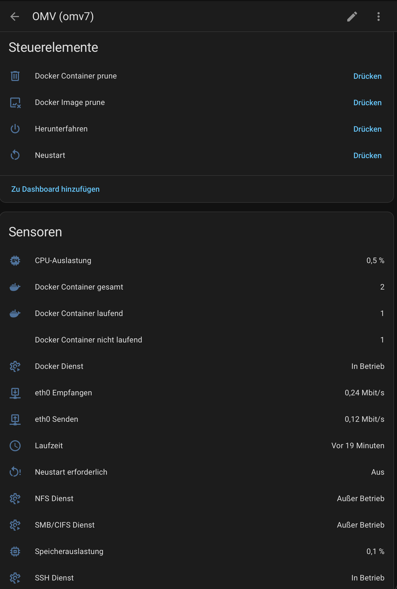
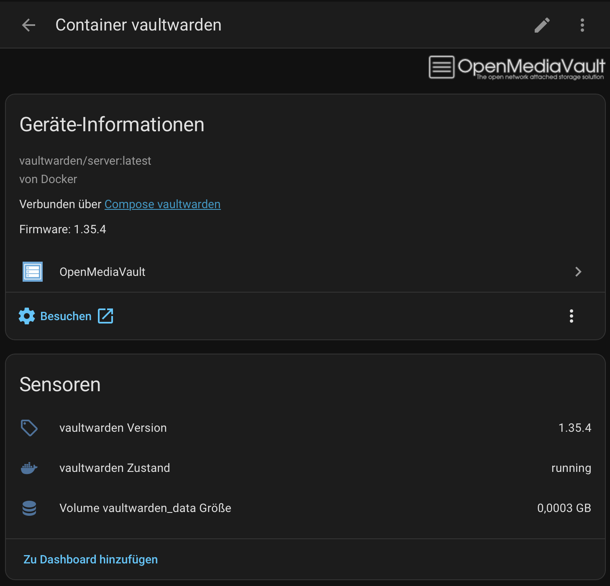
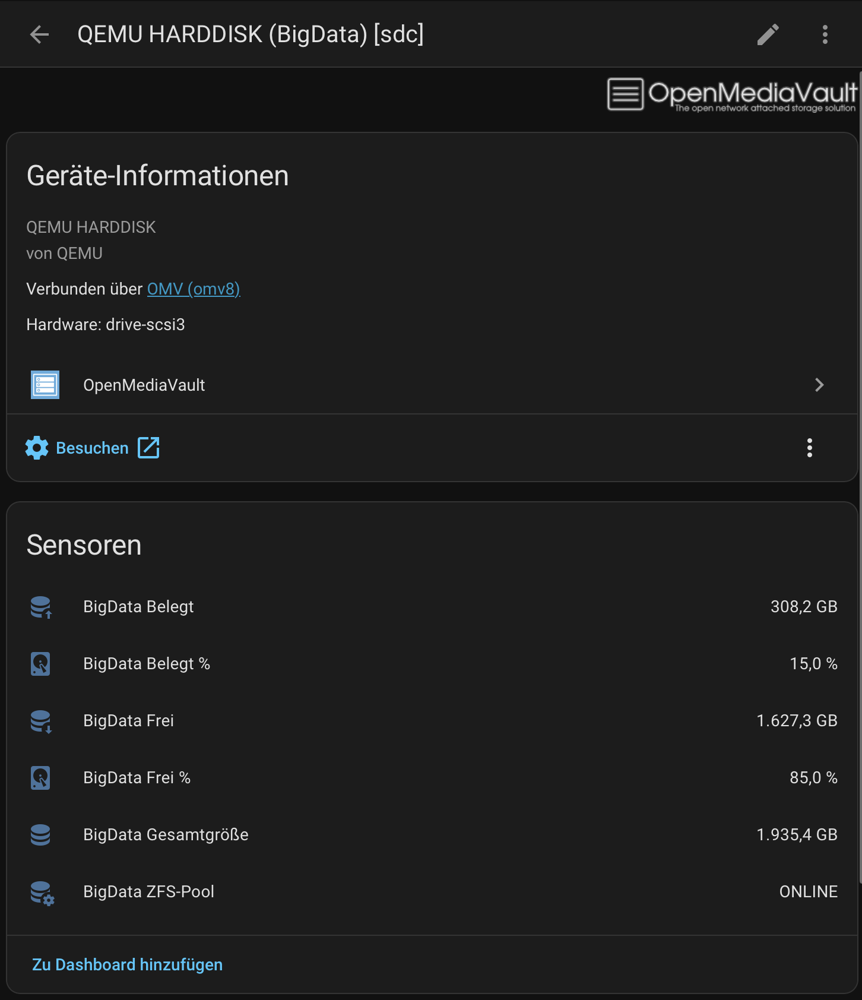
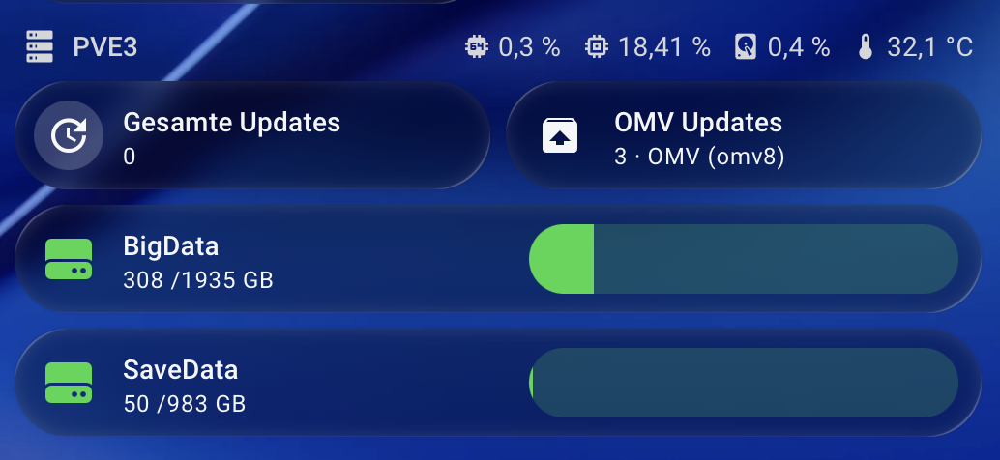

# OpenMediaVault (OMV) for Home Assistant

[](https://hacs.xyz)
[](https://github.com/sponsors/slydlake)

Monitor and control your OpenMediaVault NAS from Home Assistant.

> **Note:** This is an independent community project and is **not** affiliated with or endorsed by the OpenMediaVault project or its developers.


## About

This integration is a full modernization of [tomaae/homeassistant-openmediavault](https://github.com/tomaae/homeassistant-openmediavault), building on the groundwork laid by [cneuen/homeassistant-openmediavault](https://github.com/cneuen/homeassistant-openmediavault). Selected compatibility improvements from [Boci-HA/homeassistant-openmediavault](https://github.com/Boci-HA/homeassistant-openmediavault) have also been incorporated.

The original integration relied on a synchronous, poll-based controller that no longer fits the current Home Assistant architecture. This fork replaces that foundation with a native async client, a `DataUpdateCoordinator`-driven update cycle, and a platform structure aligned with modern HA conventions. Alongside that architectural shift, the scope of what the integration monitors has grown substantially: per-resource device modeling, Docker Compose support, ZFS pool awareness, RAID synthesis, dynamic localized entity names, capacity sensors, and a richer options flow are all new additions rather than ports of existing functionality.

## Features

- Async OMV JSON-RPC client based on aiohttp
- DataUpdateCoordinator architecture for predictable polling and updates
- CPU, memory, temperature, filesystem, disk, SMART, network, RAID, and optional ZFS monitoring
- Per-resource device modeling — disks, RAIDs, filesystems, ZFS pools, and Docker containers each appear as separate HA devices
- Docker Compose support with per-container state, version, and lifecycle button entities
- Kubernetes workload monitoring through the openmediavault-k8s plugin, with state, restarts, CPU and memory per workload plus a button that recreates its pods
- Native Home Assistant update entity with pending package count, per-package release details in the More Info dialog, a direct link to the OMV updates page, one-click package installation, and reboot-only mode when no further packages are pending
- Binary sensor for reboot requirement and OMV service health
- Reboot and shutdown buttons
- Localized dynamic entity names that follow the active HA language

## Supported Versions

- OpenMediaVault 7 and 8
- Home Assistant 2025.5 or newer
- Python 3.13.2 or newer for local development and CI

The active integration domain is omv.

## Screenshots







## Installation

### Install using HACS (recommended)

[](https://my.home-assistant.io/redirect/hacs_repository/?owner=slybase&repository=homeassistant-openmediavault&category=integration)

To add manually: open **HACS** > **Integrations** > three-dot menu > **Custom repositories** > add `https://github.com/slybase/homeassistant-openmediavault` (category: Integration) > **Download**.

After installing, restart Home Assistant. Then open **Settings** > **Devices & Services** > **Add Integration** and search for **OpenMediaVault**.

### Install manually

Copy `custom_components/omv/` from this repository into your HA `config/custom_components/` directory. Restart Home Assistant, then add the integration as described above.

## Setup

The config flow asks for:

| Field | Example | Notes |
|---|---|---|
| **Host** | `192.168.1.100` or `mynas.local` | IP address or hostname — **no** `http://` prefix and **no** port suffix |
| **Username** | `admin` | Default OMV admin account |
| **Password** | _(your OMV password)_ | |
| **Port** | `80` | Default for HTTP. Use `443` (or your custom port) when SSL is enabled |
| **SSL** | off | Enable if your OMV is reachable via HTTPS |
| **SSL verification** | on | Disable only when using a self-signed certificate |

### Two-factor authentication (TOTP)

If the OMV account has 2FA enabled (OMV 8.5+), the config flow asks for a second factor after the credentials step. You can provide **either**:

- **Verification code** — a one-time 6-digit code from your authenticator app. It is valid for this login only: after a Home Assistant restart or an expired OMV session, Home Assistant will ask you to reauthenticate.
- **TOTP secret** (recommended) — the Base32 secret behind your authenticator entry. It is stored with the config entry (same confidentiality class as the password) and lets the integration answer OMV's 2FA challenge automatically, so restarts and session expiry no longer require manual reauthentication.

You can copy the secret from OMV at any time — even after 2FA has already been set up: in the OMV WebUI open **Users** > **2FA TOTP**, select your username, and copy the displayed secret.

### Using a dedicated (non-`admin`) OMV user

OMV's API only recognizes two access levels: **Administrator** and plain **User**, decided solely by membership in the `openmediavault-admin` system group. Every RPC this integration calls — disks, SMART, filesystems, network, services, Compose, KVM, ZFS, rsync, cron, etc. — requires the Administrator role; there is no finer-grained or read-only permission level to scope it down to.

If you'd rather not use the built-in `admin` account, create a new user under **Users** > **Users** in the OMV WebUI and add it to the **openmediavault-admin** group (shown as **Administrators** in the group picker). Without this group membership the account can still log in, but OMV rejects every RPC call this integration depends on with a permission error, so the config flow and every sensor/control would fail.

## Configuration

After setup, the options flow lets you adjust:

- The scan interval
- The SMART polling interval — how often SMART data (status, attributes, disk temperature) is read. Reading SMART wakes disks from standby, so a larger interval lets disks spin down for power saving. Defaults to the scan interval.
- Whether SMART polling is disabled entirely — disks are then never woken by the integration, but SMART status, SMART attributes, and disk temperature entities become unavailable
- Which disks, filesystems, network interfaces, services, RAIDs, ZFS pools, Compose projects, containers, and Kubernetes workloads are monitored — resources not selected simply disappear from Home Assistant

## Entities

### System (hub device)

- CPU utilization, memory usage, CPU temperature, uptime, available package updates
- Intel iGPU load and current frequency (when available via sysfs)
- Docker container summary: total, running, and not-running counts
- **Update entity**: exposes OMV updates as a native Home Assistant update card with the installed OMV version, a synthetic latest version while packages or a reboot are pending, per-package release details in the **More Info** dialog, and a direct link to the OMV updates page; the **Install** button runs `apt update` + `apt upgrade` on OMV and waits for completion, and when only a reboot is pending (no further packages), pressing **Install** triggers a system reboot instead
- Binary sensor: reboot required
- Buttons: Reboot, Shutdown

### Disk devices (one device per physical disk and logical RAID/md device)

- Temperature
- Used %, free %, used size, free size, total size
- SMART status and SMART attributes (Raw Read Error Rate, Reallocated Sector Count, Pending Sector Count, Uncorrectable Sector Count, Power On Hours, Start Stop Count, Load Cycle Count)
- SSD/NVMe endurance (when the drive reports it): wear level (%), total data written (TB), total data read (TB) — from the NVMe health log (`Percentage Used`, `Data Units Written/Read`) or the SATA SSD wear attributes (`Wear_Leveling_Count`, `SSD_Life_Left`, `Media_Wearout_Indicator`, `Percent_Lifetime_Remain`, `Total_LBAs_Written/Read`); NVMe sensors expose the full health log (available spare, unsafe shutdowns, media errors, …) as attributes

### Filesystem devices (one device per mounted filesystem)

- Used %, free %, used size, free size, total size

### Network interface devices

- TX rate (Mbps), RX rate (Mbps)

### RAID devices

- RAID health status

**Note:** On OMV 7/8, install the [`openmediavault-md`](https://github.com/openmediavault-plugin-developers/openmediavault-md) plugin for RAID member detection. Without it, OMV does not expose the md array's member disks, so the integration can show the array itself but cannot list its members.

### ZFS pool devices

- Pool status

### TempMon sensors (requires `openmediavault-tempmon`)

The [`openmediavault-tempmon`](https://github.com/openmediavault-plugin-developers/openmediavault-tempmon) plugin lets you expose any temperature sensor on the OMV host to Home Assistant. Each configured sensor becomes its own HA entity (named after the sensor name you set in OMV).

**Use case: ARM CPU temperature (e.g. Rock5 ITX / Armbian)**

OMV's built-in CPU temperature sensor reads from `thermal_zone0`, which returns 0 on many ARM SoCs. Install `openmediavault-tempmon` via OMV-Extras and configure a custom sensor:

| Field | Value |
|---|---|
| Name | `CPU Temp` (or any label) |
| Script path | `/usr/sbin/cpu-temp` |
| Script | `cat /sys/class/hwmon/hwmon0/temp1_input` |
| Divisor | `1000` (sensor reports millidegrees) |

Once saved in OMV, the integration picks up the sensor automatically on the next coordinator refresh. No integration restart required.

> **Tip:** The correct hwmon path varies by board. Check `/etc/armbianmonitor/datasources/soctemp` on Armbian systems — it is a symlink to the right input file.

### OMV service devices

- Binary sensor: service running / not running

### Docker Compose project devices (one device per project)

- Project status, total containers, running containers, not-running containers
- Buttons: `compose up`, `compose down`, `start`, `stop`, `pull`

### System-wide Docker buttons (on the hub device)

- `docker image prune`, `docker container prune`

### Container devices (one device per container)

- State, status detail, created timestamp, started timestamp, image version
- Volume size (when reported by OMV)

### Kubernetes workloads (requires `openmediavault-k8s`)

If you run apps with the [openmediavault-k8s](https://github.com/openmediavault/openmediavault/tree/master/deb/openmediavault-k8s) plugin, the integration can show each of your Kubernetes workloads in Home Assistant. It only does this when the plugin is installed and the Kubernetes (`k3s`) service is enabled in OMV. If either of those is missing, the integration sends no Kubernetes requests at all.

#### What you get

Every Deployment, StatefulSet and DaemonSet becomes its own device, named `Kubernetes <namespace>/<name>`. Each of these devices has four sensors and one button:

- State tells you whether the workload is healthy. The possible values are `running`, `progressing` (a rollout is still going on), `degraded` (some replicas are ready, but not all of them), `unavailable` (no replica is ready) and `scaled_down` (you asked for zero replicas). The attributes list the namespace, the kind, the replica counts, the pod names and the images.
- Restarts is the total number of container restarts across the pods of the workload. When a pod gets replaced, its count starts again from zero.
- CPU shows how much of the node's CPU the workload uses, as a percentage. The `cpu_millicores` attribute keeps the raw value, which helps with very quiet apps that round down to 0.00 %.
- Memory shows how much memory the workload uses, in MiB.
- The Recreate pods button deletes the pods of the workload so that Kubernetes starts fresh ones. The section below explains how it behaves.

The hub device also gets three counters: the total number of workloads, how many of them are running and how many are not.

Pods that belong to a Job or a CronJob are skipped, and so are pods that no controller owns. They come and go too often to make useful devices.

CPU and memory come from the Kubernetes metrics-server. k3s installs it by default, so you most likely have it already. If your cluster does not have it, those two sensors show `unknown` and everything else keeps working.

#### Choosing which workloads to monitor

The options dialog has a Selected Kubernetes workloads field that works like the fields for containers and VMs. When you remove a workload from that list, its device and entities are removed from Home Assistant as well.

Watch out for one thing when you upgrade an existing installation. Your saved options do not contain the new field yet, so right after the update the integration shows all of your workloads. The options dialog, however, opens with the new field empty, because new resource types are strictly opt-in once you have saved any selection (the VM selection behaves the same way). If you save the dialog without ticking anything there, every Kubernetes workload disappears from Home Assistant. Pick the workloads you care about before you press Submit.

#### How the Recreate pods button works

The button sends one `Kubectl.delete` request for each pod of the workload. A Deployment, StatefulSet or DaemonSet always replaces a pod that was deleted, so a new pod starts right away. The OMV documentation recommends the same move for updating an app: "In most cases, it is sufficient to first delete the image and then the pod of the application to be updated" ([OMV docs](https://docs.openmediavault.org/en/stable/plugins/available/k8s.html)).

Keep in mind that all pods of the workload are deleted at the same time. A workload with a single replica is offline for a few seconds while its new pod starts.

On the NAS, `kubectl delete` waits until the old pod has completely stopped. A pod may take as long as its `terminationGracePeriodSeconds` to stop, and some apps set that to a minute or more. The integration does not wait that long. It stops waiting after 10 seconds per pod and only writes an INFO line to the log. This is safe because the delete is not cancelled when the caller stops waiting. In a test on OMV 8 with openmediavault-k8s 8.2.9-1, the caller was stopped 5 seconds into the delete of a pod with a 45 second grace period. The old pod still finished terminating, and its replacement was running 7 seconds later.

While the button is working, other requests to OMV have to wait, and that includes the next regular update. The 10 second limit keeps that delay short.

You will not find a button to stop, start or scale a workload. The plugin has no RPC that does that, and its only write method is `Kubectl.apply`, which expects a full manifest. Sending a partial manifest could wipe settings from apps that were installed with a recipe or with Helm, so this integration does not use it.

#### How much load this puts on the NAS

Each update makes two extra RPC calls. The first one asks for workloads and pods together, and the second one asks for the pod metrics. The integration also needs to know how much CPU the node has, but it asks for that only about once an hour. On a test system (OMV 8 on an Intel i5-4690T with 32 workloads and 36 pods) the two calls took about 0.26 and 0.11 seconds. Nothing new gets installed in the cluster. The metrics come from the metrics-server that k3s already runs, which used about 8 millicores of CPU and 25 MiB of memory on that system.

#### Why it is built this way

These are the decisions behind the feature, together with where they come from. The OMV forum was offline while this was written ([openmediavault#2301](https://github.com/openmediavault/openmediavault/issues/2301)), so the quotes come from GitHub and from the official documentation.

- The feature talks to OMV and to nothing else. Everything in this integration goes through OMV's JSON-RPC API, and plugin features are read with `_fetch_optional` so that they disappear cleanly when the plugin is not installed. That rule is spelled out in [#158](https://github.com/SlyBase/homeassistant-openmediavault/issues/158). The openmediavault-k8s plugin happens to ship a `Kubectl` RPC service, and its `getList` method returns any Kubernetes resource as JSON. Because of that, you need no kubeconfig, no service account token and no extra port.
- The feature stays small on purpose. The OMV maintainer describes the plugin as "a single-node Kubernetes environment using K3s; nothing more" ([openmediavault#1722](https://github.com/openmediavault/openmediavault/pull/1722)). He also wrote: "The plugin UI was always intended solely to provide a quick overview. Everything else was meant to be done using external tools." ([openmediavault#2163](https://github.com/openmediavault/openmediavault/issues/2163)). The OMV docs say that OMV "offers a rudimentary UI for managing simple tasks in the cluster" and point to tools like Rancher or k9s for the rest. Following that idea, this feature shows the few numbers you would want on a dashboard and adds one safe action. It does not try to become a Kubernetes management tool.
- There is no monitoring stack to install. A Prometheus setup would give you much more data, but it costs a lot of memory for a NAS. The kube-state-metrics README alone recommends "250MiB memory" and "0.1 cores" before you even add Prometheus ([kube-state-metrics](https://github.com/kubernetes/kube-state-metrics)). OMV does not offer a recipe for it, and the idea of a monitoring plugin is still an open backlog item ([openmediavault#1833](https://github.com/openmediavault/openmediavault/issues/1833)). Glances does not help here either, because it cannot see containerd containers yet ([nicolargo/glances#2226](https://github.com/nicolargo/glances/issues/2226)).
- The controls follow the VM feature. When VM support was added, the destructive `force` command was "intentionally not exposed" (see the 2.5.0 entry in the CHANGELOG). The Recreate pods button follows the same idea. Kubernetes is built to recover from deleted pods, but it cannot repair a half-applied manifest.

#### Ideas for the openmediavault-k8s plugin

A few extra RPC methods in the plugin would allow much finer control while keeping the rule that everything goes through OMV. None of them exist today, so treat this list as suggestions for the [openmediavault](https://github.com/openmediavault/openmediavault) project.

- `Kubectl.scale` with type, name, namespace and replicas, running `kubectl scale`. With that method, Home Assistant could offer a real on/off switch for each workload. Scaling to 0 would stop an app, and scaling back to the previous count would start it again.
- `Kubectl.rolloutRestart` with type, name and namespace, running `kubectl rollout restart`. This replaces the pods one at a time and waits until each new pod is ready, so an app with several replicas stays online. It would make a better default than deleting all pods at once.
- A `wait` flag on `Kubectl.delete` that maps to `kubectl delete --wait=false`. The call would then return as soon as Kubernetes accepts the delete, and clients would not need a timeout to avoid blocking.
- Label and field selectors on `Kubectl.getList`. Right now the pod list returns every field of every pod, which is about 190 KB for 36 pods. With a selector, or with a way to ask for specific columns, a client could fetch only the fields it shows.
- An official way to read metrics, for example a `Kubectl.top` method. Asking `getList` for `pods.metrics.k8s.io` works today, but it relies on `getList` passing the type to kubectl unchanged, which is not a documented feature.
- A read-only permission for the list and stats methods. Every Kubectl method currently requires the OMV administrator role, so Home Assistant needs an admin account just to read numbers.
- Suspend and resume for CronJobs, for example by patching `spec.suspend`. That would allow a switch that pauses a scheduled job.

## Development

### Environment

Install the local test and development dependencies with:

```bash
pip install -e ".[test,dev]"
```

### Local Validation

```bash
.venv/bin/python -m ruff check custom_components tests
.venv/bin/python -m pytest tests -q
.venv/bin/python -m pytest tests --cov=custom_components/omv --cov-report=term-missing
```

### Debug Logging

```yaml
logger:
  default: info
  logs:
    custom_components.omv: debug
```

## Compatibility Notes

See docs/omv-rpc-compatibility.md for the current RPC compatibility summary and the live probe workflow for validating OMV7 and OMV8 side by side.